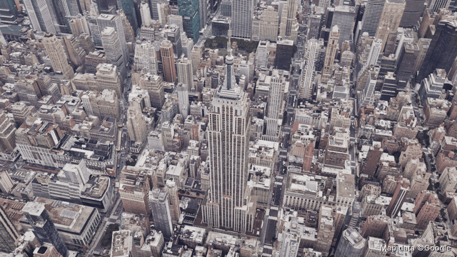
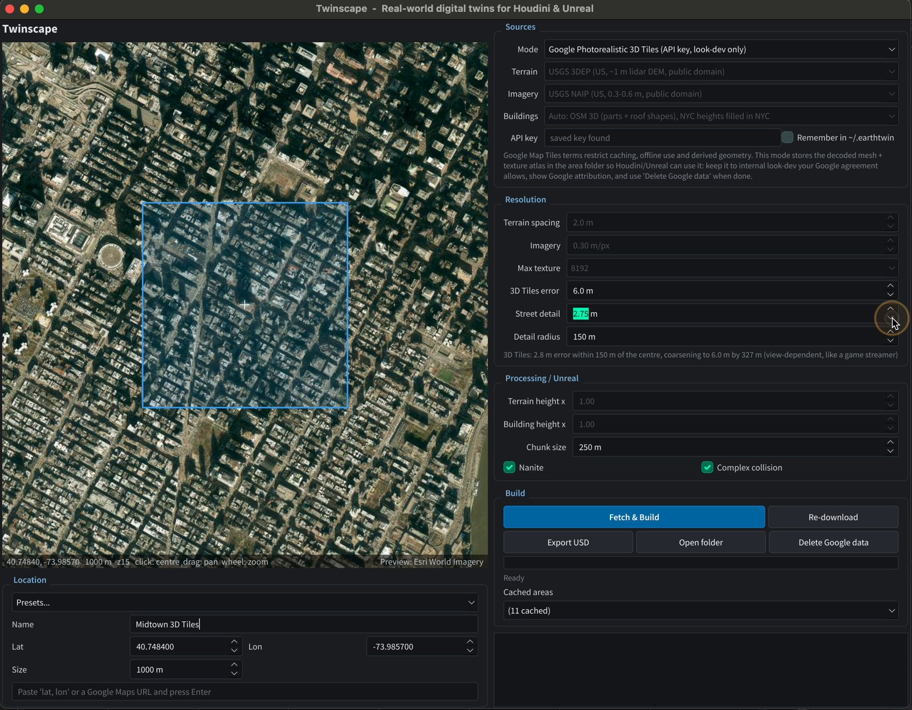
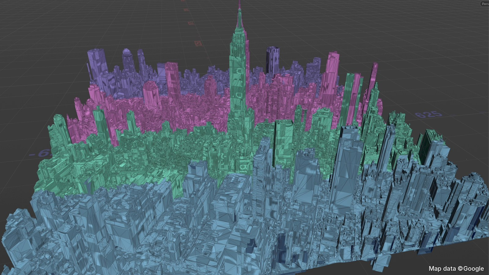
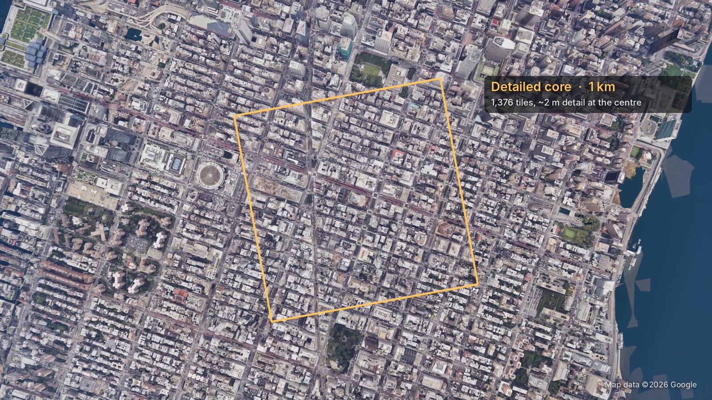
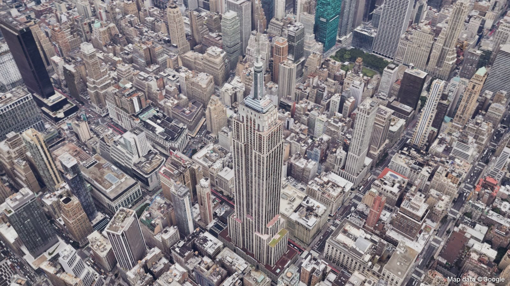
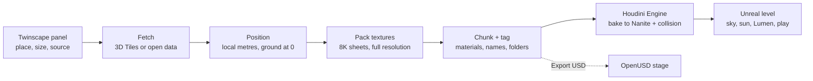
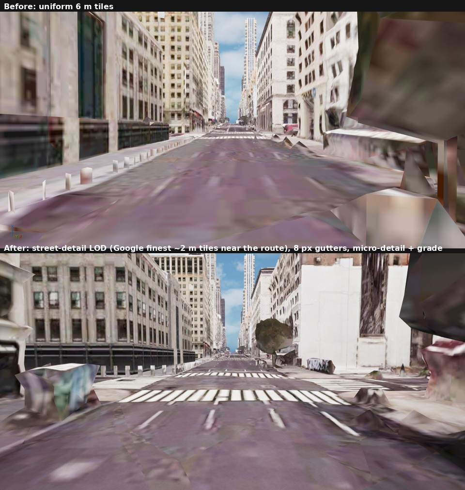

# Twinscape

**Real places, rebuilt as real-time digital twins: from a point on the map to an explorable city in Unreal Engine.**



Twinscape is a Houdini + Unreal pipeline that turns real-world 3D tile data into photoreal, real-time environments. In a PySide panel inside Houdini you pick a location, the area size and the data source (Google Photorealistic 3D Tiles or open data). Twinscape fetches the tiles, positions them accurately and packs the textures at full resolution. It then splits the area into chunks with the naming and material assignments Unreal needs to load and cull them efficiently. Houdini Engine bakes everything into Nanite static meshes with collision, ready to fly through in Unreal.

▶ **[Watch the 2.5-minute walkthrough](docs/media/twinscape_explainer_720p.mp4)**: ingestion in Houdini, the level in Unreal, then an aerial fly-through.

<p align="center">
  
  
</p>
<p align="center">
  
  
</p>

---

## What it does

* **Pick any place.** Click a map, paste coordinates or a Google Maps link, or choose a preset. Set the capture size, from a few blocks up to several kilometres.
* **Choose the data.**
  * **Google Photorealistic 3D Tiles:** photographed 3D cities, with your own API key.
  * **Open data:** USGS lidar terrain, NAIP aerial imagery and OpenStreetMap 3D buildings with real roof shapes. Open data works without a key.
* **Detail where it matters.** Tiles refine to Google's finest level near the centre of the area and coarsen with distance, like a game streaming its world. You can also add a coarser **context ring** around the core so the skyline stays complete.
* **Accurate placement.** Everything lands in a local, metre-accurate frame centred on your site, with the ground at zero.
* **Textures at full resolution.** Every photo texture is packed 1:1 into 8K texture sheets that Unreal streams as virtual textures.
* **Ready for Unreal.** Each chunk carries its material, mesh name and bake folder. Houdini Engine bakes them into Nanite static meshes with collision, and the level gets physically based daylight, sky and atmosphere.
* **Cached and repeatable.** Every area is stored once with a manifest of sources and credits, so rebuilding is instant and works offline.
* **OpenUSD export.** One click writes the area as a USD stage with materials and its latitude/longitude.

## How it works



The details are in [docs/ARCHITECTURE.md](docs/ARCHITECTURE.md).

## Where it could be useful

1. **Arch-viz, real estate and urban planning:** drop a proposed building into its real surroundings and judge massing, sightlines and skyline impact.
2. **Previs and virtual production:** scout locations, block camera moves or build LED-wall backgrounds remotely.
3. **Simulation:** test drone flight paths, line of sight, coverage or emergency response over real terrain.
4. **Digital twins:** an accurate base for layering live data such as traffic, sensors or energy use.

## Quick start

You need Houdini 22 and Unreal Engine 5.8 with the Houdini Engine plugin. [docs/SETUP.md](docs/SETUP.md) has the details, other platforms and troubleshooting.

```bash
git clone https://github.com/sushilgr/twinscape.git
cd twinscape
python3 install.py            # writes a Houdini package pointing at this folder (or: hython install.py)
```

**Houdini**

1. Restart Houdini and open `houdini/scenes/Twinscape_demo.hip`. Midtown and Lower Manhattan are bundled as open-data samples, so they cook offline without an API key.
2. Select a `city_builder` node and press **Open Twinscape Panel** to capture a new place.
3. Optional: run `hython tools/selftest.py` to check the install without the UI.

**Unreal**

1. Copy the Houdini Engine plugin into `unreal/TwinscapeUE/Plugins/HoudiniEngine`, then open `unreal/TwinscapeUE/TwinscapeUE.uproject`. If the log says it can't find Houdini, set *Use Custom Houdini Location* ([setup, step 4](docs/SETUP.md#4-unreal-project)).
2. Choose **Twinscape > Build sample: Midtown** from the main menu. It cooks the sample through Houdini Engine, bakes Nanite meshes, lights the level and saves it.
3. Press **Play**. To walk the streets as the UE5 mannequin, first add the Third Person content pack (see [docs/UNREAL.md](docs/UNREAL.md)).

To use Google Photorealistic 3D Tiles, enable the **Map Tiles API** on a Google Maps Platform key and paste it into the panel. The key stays on your machine and is never written into scenes or caches.

## Technical highlights

* **Tile streaming in a DCC.** A breadth-first OGC 3D Tiles traversal with distance-based refinement, oriented-box culling against the capture area, parallel tileset fetches and a JSON-only dry run that sizes a capture before downloading anything.
* **Getting the transforms right.** glTF/Draco decoding through the full chain: tile transform, RTC centre, Y-up to Z-up, node matrices, then Earth-centred coordinates to the local frame. A synthetic-tile test checks it to within a millimetre.
* **Texture handling at scale.** Around 1,400 textures of mixed sizes per area are shelf-packed 1:1 into 8K pages, with gutters so mip-maps don't bleed, and streamed as virtual textures in Unreal.
* **An HDA generated from code.** The network, VEX, parameters, help and Python module are all built by `build_hda.py`, so the asset is diffable and rebuilds under any licence.
* **Automated Unreal pipeline.** Houdini Engine's public API drives instantiate, cook and bake. Nanite, collision and level setup run across editor ticks to keep the editor responsive, and the Movie Render Queue handles cinematics.
* **Tested from a fresh clone.** `tools/selftest.py` cooks both bundled samples offline. A clean clone on macOS goes from `install.py` to a baked, playable Unreal level with Houdini 22.0 and UE 5.8.

## Documentation

| | |
|---|---|
| [Setup](docs/SETUP.md) | install, API key, Houdini Engine for Unreal, troubleshooting |
| [User guide](docs/USER_GUIDE.md) | the panel, every HDA parameter, outputs and attributes |
| [Unreal](docs/UNREAL.md) | project template, one-click samples, the Python pipeline, cinematics, playing as Manny |
| [Architecture](docs/ARCHITECTURE.md) | data flow, coordinate frames, tile streaming, texture packing, chunking |
| [Data & licensing](docs/DATA_AND_LICENSING.md) | sources, credits, and what you may and may not share |
| [Roadmap](docs/ROADMAP.md) | the street-level layer, OpenUSD, Omniverse and Isaac Sim |

## Current limits and what's next

At street level the results don't yet work as a "playable" environment. Rooftops, facades and the street grid read well from above. But Google's finest tiles for this Manhattan example carry about 2 m of detail, which isn't enough at human scale. Cars, trees and kerbs come out as lumpy shapes, and road textures blur up close. For now Twinscape shines for aerials, flyovers and visualization.



To fix this, the plan is to keep Google's tiles for the big picture and blend in a rebuilt ground layer from open data:

1. **City lidar and planimetrics** for kerbs, sidewalks and true ground height.
2. **Tree inventories and OpenStreetMap** for placing trees and street furniture.
3. **Road markings, materials, signage and parked cars**, generated procedurally in Houdini.

I also plan to explore OpenUSD as the master format. Houdini would write each captured area as a layered USD stage, with Google tiles, rebuilt street detail and live data in separate layers that can be updated independently. The same twin could then open directly in NVIDIA Omniverse for digital twin review, or in Isaac Sim for robotics and drone simulation, without Houdini Engine. More in the [roadmap](docs/ROADMAP.md).

## Repository layout

```
install.py                     writes the Houdini package (run once)
houdini/
  otls/                        the HDA: Twinscape City Builder
  python/earthtwin/            data layer, HDA logic, PySide panel, HDA builder, tests
  scenes/Twinscape_demo.hip    demo scene using the bundled samples
unreal/
  TwinscapeUE/                 UE 5.8 project template (config + start-up script)
  scripts/                     Unreal pipeline: materials, Houdini Engine bake, Nanite, lighting, cinematics
cache/                         per-area data; two open-data samples are included
tools/                         hython helpers: rebuild the HDA, rebuild the demo scene, self-test
docs/                          documentation and media
```

The code still uses its working name, `earthtwin`, for the Python package, the HDA type (`earthtwin::city_builder::1.0`) and the Unreal script modules, so existing scenes keep loading. Everything you see in the UI says Twinscape.

## Credits

Built by **Sushil Gangaraju** with Houdini 22, Houdini Engine and Unreal Engine 5.8.

Map data ©Google (Photorealistic 3D Tiles). Elevation: USGS 3D Elevation Program. Imagery: USDA NAIP. Buildings © OpenStreetMap contributors (ODbL), heights from NYC Open Data. Code under the [MIT License](LICENSE); data terms in [docs/DATA_AND_LICENSING.md](docs/DATA_AND_LICENSING.md).
