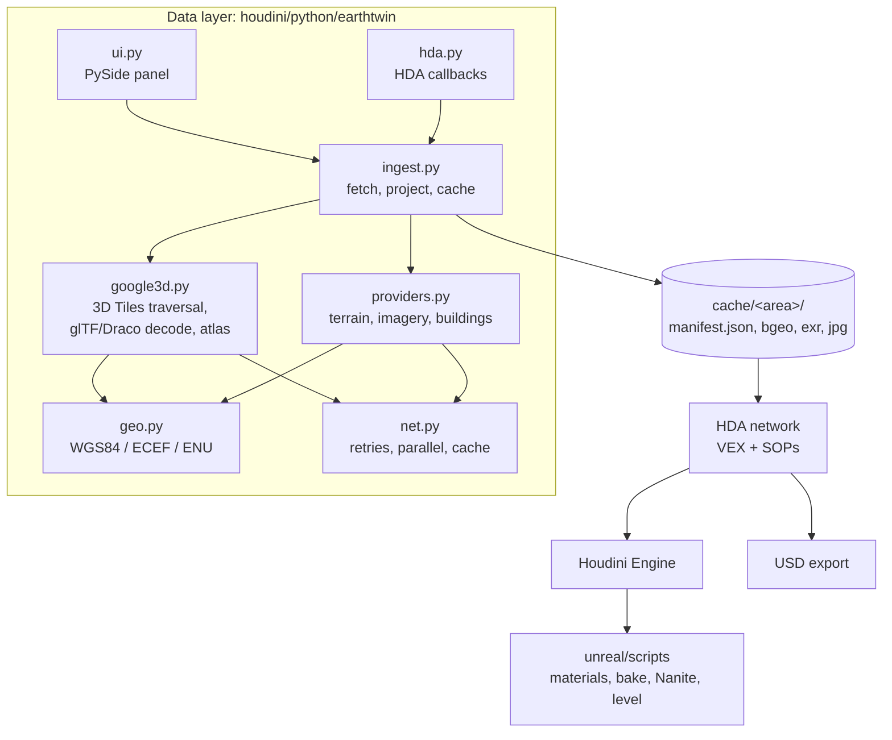

# Architecture

Twinscape is about 4,500 lines of Python and VEX in three layers. A **data layer** turns a place into cached, georeferenced files. An **HDA** turns those files into tagged geometry. An **Unreal layer** turns the tagged geometry into an optimized, lit level. Each layer only talks to the next through files and attributes, so any of them can run on its own (in hython, in PDG, in Houdini Engine).

## 1. Ingestion

### Google Photorealistic 3D Tiles (`google3d.py`)

Google serves the planet as an [OGC 3D Tiles](https://www.ogc.org/standard/3dtiles/) tree: every node has a bounding box, a *geometric error* (roughly how far its mesh may deviate from reality, in metres) and either children or content (glTF meshes, or further tilesets).

* **Traversal.** A breadth-first walk from `root.json`, fetching nested tilesets in parallel. A node is visited if its oriented box overlaps the capture square, checked in the local ENU frame rather than with a loose bounding sphere. It refines into its children while its geometric error is above the threshold for its position.
* **Detail where it matters.** The threshold isn't constant. Within the *street detail radius* of the focus point it's the street-detail error. Beyond it, it grows linearly with distance (`error × distance / radius`), which is the same rule a game engine uses for constant on-screen error, capped at the area's coarse error. In Midtown this reaches Google's finest (~2 m) tiles around the centre with 1,376 tiles instead of the ~3,700 a uniform 3 m would need.
* **Dry runs.** `plan()` walks only the JSON and reports tile counts and errors per distance band, in a few seconds, before anything heavy is downloaded.
* **Decode.** Meshes are Draco-compressed glTF. Each one goes through the full transform chain (tile transform · `CESIUM_RTC` centre · glTF Y-up → Z-up · node matrices), then from Earth-centred ECEF into the local frame. Textures are kept as the original JPEG bytes. Nothing is written to disk until the end.
* **Ground.** Heights come in as ellipsoid heights, so the ground at the centre (a low percentile of the points near the centre) becomes `y = 0`. A context ring reuses its core's reference height so the two line up.

### Open data (`providers.py`)

* **Terrain:** USGS 3DEP (1 m lidar-derived DEM, via the National Map's ImageServer), AWS Terrain Tiles (global) or the Google Elevation API, resampled to a grid and written as a float EXR. If a service is down, Twinscape falls back to AWS rather than failing the build.
* **Imagery:** USGS NAIP mosaics, Esri World Imagery or Google 2D satellite tiles, reprojected from Web Mercator to the local square at a power-of-two size.
* **Buildings:** OpenStreetMap through Overpass (with several mirrors), including `building:part`, `min_height`, `roof:shape/height/direction/orientation` and `building:colour`. In New York, missing heights are filled from NYC Open Data's surveyed roof heights.
* **Facades:** four procedural facade styles with matching glass masks, generated once and shared.

### Caching (`ingest.py`)

Every area is a folder named `<name>_<hash>`, where the hash covers every setting that changes the result (coordinates rounded to ~1 m, because Houdini Engine passes float32 parameters). A `manifest.json` records settings, sources actually used, credits, reference height and stats. Cooking a cached area never touches the network.

## 2. Packing textures (`google3d.build_atlas`)

A Manhattan square has around 1,400 tile textures, each 256–1024 px and often not square. They're packed **at native resolution** into 8K pages with shelf packing (tallest first). Each texture gets an 8-pixel edge-extended gutter so mip-maps don't bleed between neighbours, and UVs are remapped into the page. Five pages cover Midtown. Unreal streams them as virtual textures, so memory follows what's on screen.

## 3. The HDA network (`build_hda.py`)

The HDA is generated entirely by code (`tools/build_hda.py`): network, VEX, parameters, help and Python module. That keeps it diffable and rebuildable under any licence.

* **`load_area`** (Python SOP): fetch-on-cook if needed, then load the cached mesh or footprints and publish the area's metadata as detail attributes.
* **Google branch:** clip to the square, add normals.
* **Open-data branch:** a terrain grid sampled in VEX, buildings extruded from their real base to their real height, roof shapes generated in VEX from OSM tags, facade UVs by floor and bay, colours from OSM.
* **Unreal prep:** `unreal_assign` sets `unreal_material`, the chunk id and the bake name per primitive. `unreal_detail` sets the bake folder and Nanite. `pack_chunks` packs each chunk into one primitive, so Houdini Engine emits exactly one static mesh per chunk. The attribute reference is in [USER_GUIDE.md](USER_GUIDE.md#output-attributes).

## 4. Unreal (`unreal/scripts`)

* **Materials** are built from Python (`MaterialEditingLibrary`), so no binary assets ship with the repository. Google tiles use an **unlit** master, because their textures already contain baked lighting. Its brightness is calibrated to the physical sun so photogrammetry and lit geometry sit in the same exposure.
* **Houdini Engine** is driven through the public API (`HoudiniPublicAPI`): instantiate, set parameters, cook, bake to actors, then remove the temporary outputs.
* **Finishing** runs on the editor tick: Nanite with a full-detail fallback, complex-as-simple collision, no distance fields, static mobility.
* **Level:** a physical sun (75,000 lux), sky atmosphere, real-time sky light, height fog, volumetric clouds, daylight exposure and Lumen GI and reflections.
* **Cinematics:** Level Sequences generated from camera paths, rendered with the Movie Render Queue.

## Coordinate frames

| Frame | Axes | Units | Used by |
|---|---|---|---|
| WGS84 | lat, lon, ellipsoid height | degrees, m | inputs, manifests |
| ECEF | Earth-centred X, Y, Z | m | 3D Tiles content |
| Local ENU | east, north, up from the area centre | m | all processing |
| Houdini | x = east, y = up, z = south | m | the HDA |
| Unreal | X = east, Y = south, Z = up | cm | the level |

## Names

*Twinscape* is the product name. The code keeps its working name, *earthtwin*: the Python package, the HDA type `earthtwin::city_builder::1.0` and the Unreal script modules. Renaming them would break existing scenes and Unreal assets, so the rename is cosmetic for now.

## Tests

* `tools/selftest.py` cooks both bundled samples offline and checks the Unreal attributes.
* `earthtwin/tests/test_google3d.py` builds a synthetic Draco tile the way Google serves them and checks the decoder places it within a millimetre of where it should be.
