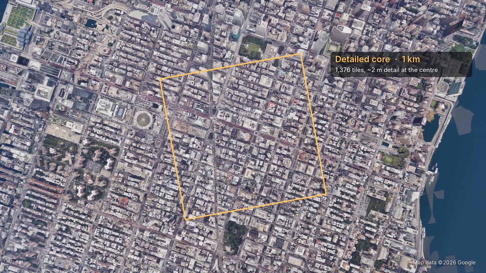
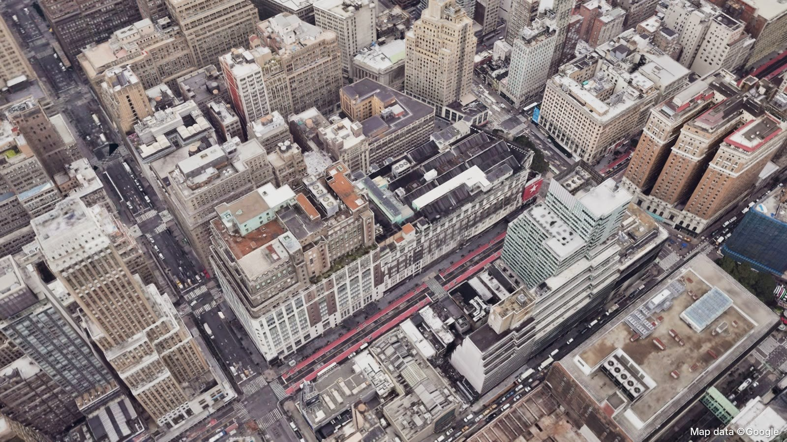

# Unreal

Twinscape's Unreal side is plain editor Python (`unreal/scripts/`), plus a small project template that loads it on start-up. Houdini Engine does the heavy lifting: it cooks the same HDA you use in Houdini and hands Unreal tagged geometry, which the scripts bake into an optimized, lit level.

## The project template

`unreal/TwinscapeUE/` contains only text files:

| File | Purpose |
|---|---|
| `TwinscapeUE.uproject` | UE 5.8, with Python, Editor Scripting, Sequencer Scripting and Movie Render Queue enabled |
| `Config/DefaultEngine.ini` | Nanite, Lumen, virtual shadow maps, virtual textures, 16× anisotropic filtering, a texture pool sized for city atlases |
| `Content/Python/init_unreal.py` | runs on start-up: finds the repository, adds `unreal/scripts` to Python and adds the **Twinscape** menu |

Add the Houdini Engine plugin to `Plugins/HoudiniEngine` (see [SETUP.md](SETUP.md#4-unreal-project)) and open the project. Generated content goes to `/Game/Twinscape` and is git-ignored.



## The Twinscape menu

| Entry | What it does |
|---|---|
| **Build sample: Midtown (open data, offline)** | the full pipeline on the bundled Midtown sample, end to end, in a few minutes |
| **Build sample: Lower Manhattan (open data, offline)** | the same for Lower Manhattan |
| Prepare shared materials | builds the master materials and facade textures |
| Create lit city level | sky, sun, atmosphere, fog, clouds, post-process, player start |
| Optimize baked meshes | Nanite with full-detail fallback, complex-as-simple collision, no distance fields |
| Apply performance cvars | the session cvars used for city scenes |
| Reload Twinscape script | for development |

A sample build runs in the background on the editor tick, so the editor stays responsive. It runs these steps:

1. Creates `/Game/Twinscape/Maps/Twinscape_Midtown` with physically based daylight (75,000 lux sun, sky atmosphere, sky light, height fog, volumetric clouds, exposure for daylight, Lumen).
2. Imports the area's aerial image and texture atlases as **virtual textures** and creates material instances.
3. Imports the HDA, instantiates it with the area's settings and lets **Houdini Engine** cook it. The node reads the cached data, so no network is needed.
4. **Bakes** every chunk to a static mesh in `/Game/Twinscape/Areas/<area>/Meshes`.
5. Gives each mesh **Nanite** (full-detail fallback) and **complex-as-simple collision**, a few meshes per tick.
6. Drops the **PlayerStart** on a street near the centre, frames the camera and saves the level.

Follow progress in the Output Log (`[Twinscape]`) or with `et.status()`.

## Playing as Manny

Add *Add > Add Feature or Content Pack > Third Person* once. When the level is built, Twinscape creates `BP_TwinscapeGameMode` with `BP_ThirdPersonCharacter` as its pawn and assigns it to the level. Without the pack you get the default fly-camera pawn.

## The Python API

Use it from the Output Log's Python console, editor utility scripts or your own tools:

```python
import earthtwin_unreal as et

et.quickstart("midtown")                       # one call: everything above

# or step by step, for any area you've built in Houdini
et.prepare_shared()                            # master materials, facades, street-detail texture
et.setup_level("/Game/Twinscape/Maps/Twinscape_Flatiron")
area_dir, man = et.find_area(name="Flatiron")
et.prepare_area(area_dir)                      # virtual textures + material instances for this area
et.instantiate(man["params"]["lat"], man["params"]["lon"], man["params"]["size"], "Flatiron")
# ... when et.status()["cooked"] >= 1:
et.bake()
et.finalize_async("/Game/Twinscape/Areas/" + man["area_id"])
```

For a Google 3D Tiles area, pass the mode and LOD settings to `instantiate`, e.g.
`{"mode": 1, "g3d_error": 6.0, "g3d_focus_error": 2.5, "g3d_focus_radius": 150.0}`.
The API key comes from the same place as in Houdini (`~/.twinscape/google_api_key` or `GOOGLE_MAPS_API_KEY`).

### Materials

| Master | Used for |
|---|---|
| `M_ET_Photo` | Google 3D Tiles. **Unlit**, because Google's textures already contain the lighting they were photographed with, so shading them again would double the shadows. It has a brightness matched to the physical sun, light desaturation, and a mean-neutral asphalt micro-detail on flat surfaces that fades out by 45 m. |
| `M_ET_Ortho` | terrain and roofs from aerial imagery (virtual texture) |
| `M_ET_Facade` | procedural facades with a glass mask and OSM building colours |
| `M_ET_Water` | rivers and harbour |

## Cinematics



`earthtwin_cine.py` turns camera paths into Level Sequences and renders them with the **Movie Render Queue**, including warm-up frames so Nanite pages and virtual textures are fully streamed. `earthtwin_shots.py` holds the shots from the demo video. They're all aerial moves that stay above roof height and pitch down far enough that the frame never reaches the horizon or the edge of the data.

```python
import earthtwin_cine as ec, earthtwin_shots as es
for name, frames in es.shots().items():
    ec.build_shot(name, frames, focal=es.FOCAL)
ec.render(list(es.shots()), "/Game/Twinscape/Maps/Twinscape_Midtown", "~/Twinscape/renders")
```

`ec.cinematic_atmosphere()` adds the slightly hazier look and the water plane used in the video.

## Performance notes

* **Nanite fallback at full detail.** Some editor views and ray tracing draw the fallback mesh; a reduced fallback breaks thin photogrammetry into shards.
* **No mesh distance fields** while baking. City meshes don't need them for Lumen hardware ray tracing, and building them for millions of triangles can stall the editor for minutes.
* **Virtual textures and 16× anisotropy.** Roads are seen at grazing angles; this is the difference between crisp and smeared asphalt.
* **Heavy work runs per tick.** On macOS, long blocking operations can crash the editor through window-server callbacks, so baking and Nanite builds are spread across frames.

## Using your own project

Add the scripts folder to Python and set `TWINSCAPE` to the repository, e.g. in your project's `Content/Python/init_unreal.py`:

```python
import os, sys
os.environ.setdefault("TWINSCAPE", "/path/to/twinscape")
sys.path.append("/path/to/twinscape/unreal/scripts")
import earthtwin_unreal as et; et.register_menu()
```

You'll also want the renderer settings from `unreal/TwinscapeUE/Config/DefaultEngine.ini`.
