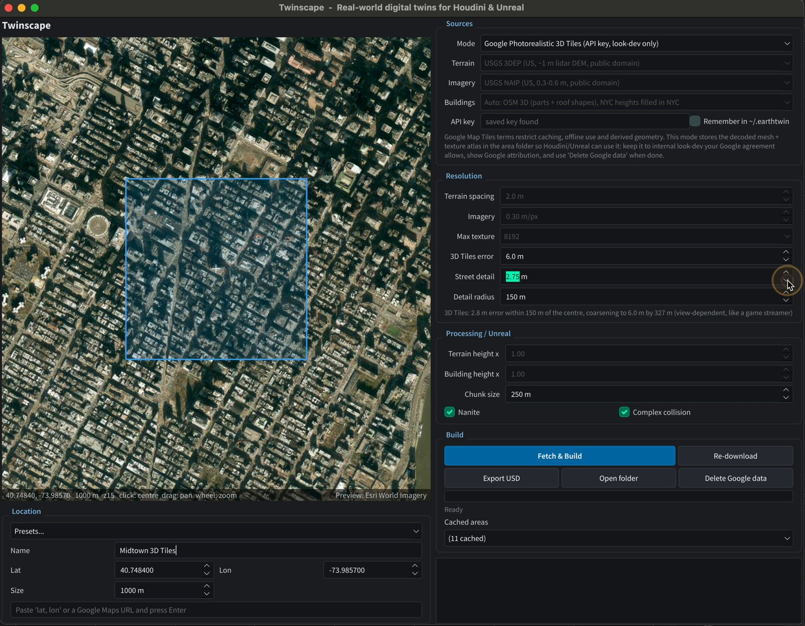
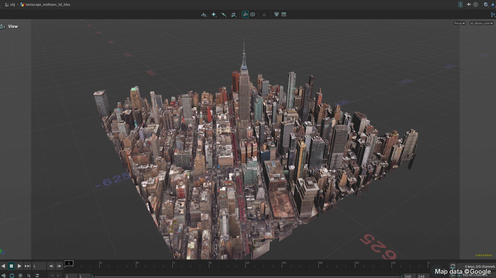
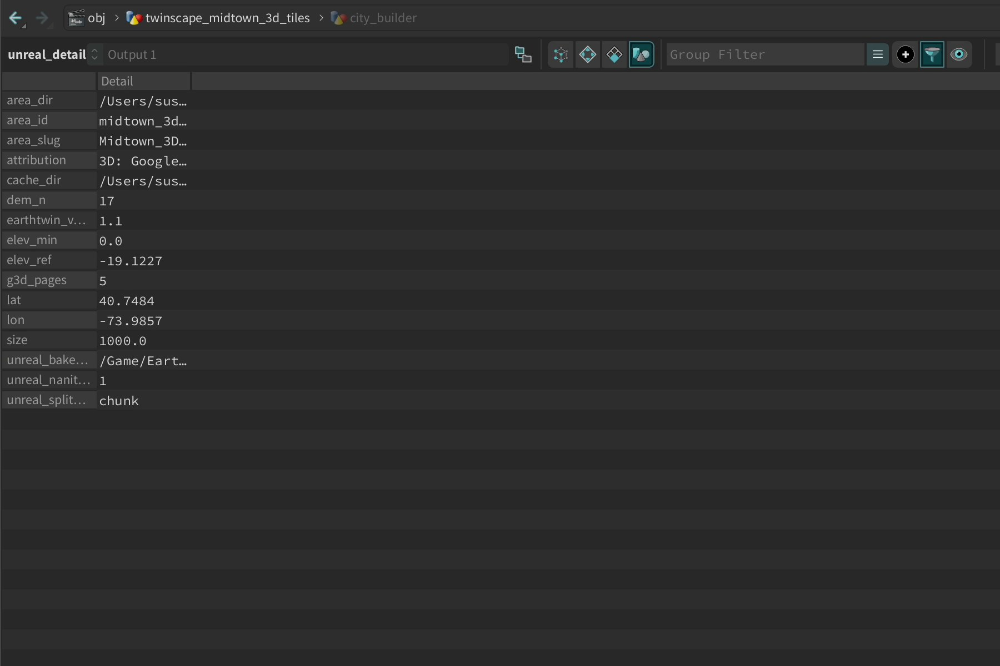

# User guide

There are two ways to drive Twinscape in Houdini, and they share the same node:

* **The Twinscape panel:** a PySide window with a map. Best for picking places and building them interactively.
* **The HDA**, *Twinscape City Builder* (`earthtwin::city_builder::1.0`): every setting is a parameter, so it also works headless, in PDG/TOPs, and inside Unreal through Houdini Engine.

## The panel

Open it from any `city_builder` node (**Open Twinscape Panel**) or from the Python Shell:

```python
import earthtwin.ui as ui; ui.show()
```



### 1. Location

* **Map:** click to centre the capture square, drag to pan, scroll to zoom. The square is drawn to scale. The map preview uses Esri World Imagery.
* **Presets:** a few ready-made areas, such as Lower Manhattan, Midtown and Times Square, plus downtown San Francisco, the Chicago Loop, the City of London and Shinjuku.
* **Paste:** type or paste `lat, lon`, or a Google Maps URL, and press Enter.
* **Name / Lat / Lon / Size:** the name labels the area folder and the Unreal assets. Size is the side of the square in metres.

### 2. Sources

| Mode | What you get | Needs |
|---|---|---|
| **Open data** | terrain from lidar, aerial imagery, OSM 3D buildings with roof shapes and procedural facades | nothing (US sources are US-only; global fallbacks exist) |
| **Google Photorealistic 3D Tiles** | Google's photographed 3D city mesh with its textures | API key with the Map Tiles API |

In open-data mode you can mix sources:

| Layer | Options |
|---|---|
| Terrain | USGS 3DEP (US, ~1 m lidar DEM) · AWS Terrain Tiles (global) · Google Elevation API · flat |
| Imagery | USGS NAIP (US, 0.3–0.6 m) · Esri World Imagery · Google 2D satellite · none |
| Buildings | Auto (OSM 3D, with NYC heights filling gaps in New York) · OSM 3D · OSM outlines · NYC Open Data footprints · none |

If a terrain service is down, Twinscape falls back to AWS Terrain Tiles rather than failing the build, and records the fallback in the manifest.

### 3. Resolution

* **Terrain spacing / Imagery / Max texture** (open data): grid spacing of the terrain mesh, target ground resolution of the aerial image, and its maximum size. The estimate line shows the resulting triangle count and image size.
* **3D Tiles error** (Google): the coarsest detail allowed, used at the edges of the area. Lower values mean finer tiles and more data.
* **Street detail / Detail radius** (Google): within the radius, tiles refine down to the street-detail error; beyond it the allowed error grows with distance. In Manhattan, Google's finest tiles sit at about 2 m, so a street detail of **2.5 m** reaches them. The defaults (6 m edges, 2.5 m within 150 m) gave 1,376 tiles and 3.3 M triangles for a 1 km Midtown square. A uniform 3 m would have been about 3,700 tiles.

### 4. Processing / Unreal

* **Terrain / building height ×:** vertical exaggeration, mostly for stylised looks.
* **Chunk size:** the area is cut into square chunks of this size, and each becomes one static mesh in Unreal. 250–300 m works well with Nanite and culling.
* **Nanite / Complex collision:** written to the output so the Unreal bake sets them up.

### 5. Build

* **Fetch & Build:** downloads anything that isn't cached yet (in the background, so Houdini stays responsive), then cooks the node. The log shows sources, timings and credits.
* **Re-download:** ignores the cache for this area.
* **Export USD:** writes the area as a `.usdc`, Y-up in metres, one mesh per chunk and material, with UsdPreviewSurface materials and lat/lon stored on the root prim.
* **Open folder / Delete Google data:** opens the area's cache folder, or removes every cached area built from Google content.
* **Cached areas:** reload any area built before. No network needed.

## The HDA

Drop *Twinscape City Builder* in a Geometry network. The parameters are grouped in tabs.

| Tab | Parameters |
|---|---|
| Location | Open Twinscape Panel · Preset · Area Name · Latitude · Longitude · Size |
| Sources | Mode · Terrain / Imagery / Buildings source · Google API Key · Terrain Spacing · Imagery Resolution · Max Texture Size · 3D Tiles Error · Street Detail Error · Street Detail Radius · Context Ring Hole |
| Data | Fetch · Open Area Folder · Delete Google Data · Auto Fetch On Cook · Cache Folder · Area Folder · Info |
| Terrain | Height Scale · Keep Triangles % · Water Plane · Water Level · Shore Band · Carve Depth |
| Buildings | Buildings on/off · Height Scale · Default Height · Min Footprint · Embed Depth · Roof Shapes · Default Pitch Scale · Irregular Roof Detail · Use OSM building:colour · Colour Strength · Facade Tile Width/Height |
| Unreal | Chunk Size · Split Into Chunk Meshes · Nanite · Complex As Simple Collision · Material Root · Bake Root · USD File · Export USD |

**Auto Fetch On Cook** lets the node download its own data on first cook. That's what Houdini Engine relies on inside Unreal. The panel switches it off while it downloads in the background, so a viewport cook never starts a second, blocking download.

**Context Ring Hole** builds a coarse ring around a detailed area that's already cached. Set the size to e.g. 4,000 m, the hole to the detailed area's size, and a coarse error (e.g. 32 m edges, 10 m near the core). Tiles inside the hole are skipped and the ring reuses the core's ground height, so the two meet cleanly.

### What's inside the network



| Stage | Nodes | What happens |
|---|---|---|
| Load | `load_area` (Python SOP) | fetches if needed, loads the cached mesh or footprints, publishes area metadata as detail attributes |
| Terrain (open data) | `terrain_*` | grid sampled from `height.exr` in VEX, reduced, UVs for the aerial image, water plane |
| Buildings (open data) | `bld_*`, `roof_*` | OSM parts with min/max heights, extrusion, roof shapes (gabled, hipped, pyramidal, domes, onion…), facade UVs, OSM colours |
| Google 3D Tiles | `g3d_clip_*`, `g3d_N` | clip to the square, normals |
| Unreal prep | `unreal_assign`, `unreal_detail`, `pack_chunks` | materials, chunk names, bake names and folders, Nanite flag, one packed primitive per chunk |

### Output attributes



| Attribute | Class | Purpose |
|---|---|---|
| `unreal_material` | primitive | material instance for each primitive, e.g. `/Game/Twinscape/Areas/<area>/MI_G3D_2` |
| `unreal_bake_name` | primitive | static mesh name per chunk, `SM_<Area>_<Kind>_<x>_<z>` |
| `unreal_bake_folder` | detail | `/Game/Twinscape/Areas/<area>/Meshes` |
| `unreal_nanite_enabled` | detail | Nanite on the generated meshes |
| `unreal_split_attr` | detail | `chunk`, one static mesh per chunk |
| `chunk` | primitive | chunk id |
| `shop_materialpath`, `material_override` | primitive | Houdini viewport and Karma materials; per-page texture for Google tiles |
| `g3d_page`, `g3d_tile` | primitive | texture-atlas page and source tile (Google mode) |
| `P`, `uv` | point / vertex | local metres; UVs into the area's atlas or aerial image |
| `lat`, `lon`, `size`, `elev_ref`, `area_id`, `attribution` | detail | where the area is, its ground reference height, its id and its data credits |

## Coordinates

Houdini works Y-up: `x` = east, `y` = up, `z` = south, in metres from the area centre, with the ground at the centre at `y = 0` (`elev_ref` holds the original height). Through Houdini Engine, Unreal receives `X` = east, `Y` = south, `Z` = up, in centimetres. So a point at `(x, y, z)` in Houdini lands at `(100x, 100z, 100y)` in Unreal.

## Caching

Each area is a folder in `cache/`, named by area plus a hash of its settings (see [cache/README.md](../cache/README.md)). Change any setting that affects the result and you get a new folder; change it back and the old one is reused. Set `TWINSCAPE_CACHE` to keep caches on another drive.

## Scripting

```python
from earthtwin import ingest
man = ingest.fetch(dict(name="Flatiron", lat=40.7411, lon=-73.9897, size=600, mode="procedural"))
print(man["area_id"], man["buildings"], man["attribution"])
```

`ingest.fetch` works in any Houdini Python process (hython, PDG work items). `google3d.plan()` gives a dry run of a 3D Tiles traversal: tile counts and errors without downloading any meshes.
